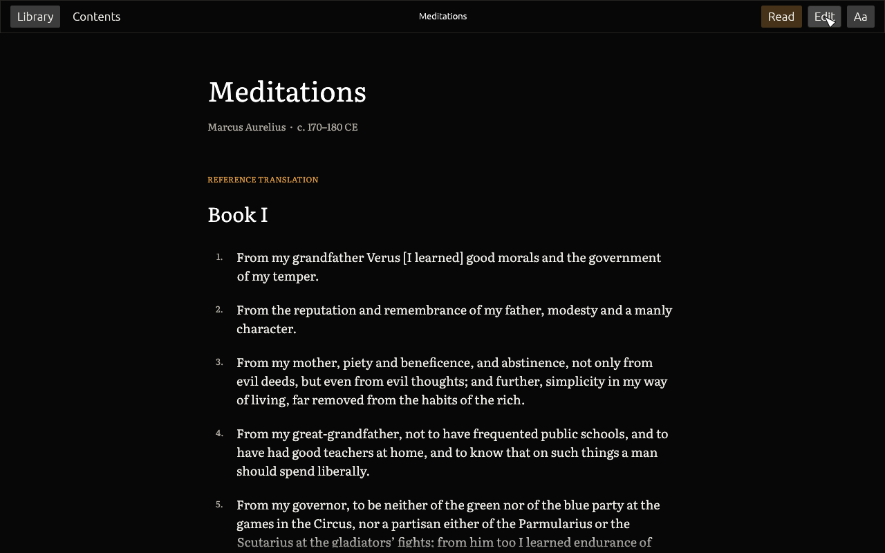

# Skribi

Skribi is a desktop reader and editor for Markdown libraries and Retex vaults.
Read long works in a continuous, chapter-aware view while keeping notes as plain
files. Open an existing Markdown or Obsidian folder, or import a Notion export.

<p align="center">
  
</p>

## Install

Download your platform’s build and `SHA256SUMS` from the
[latest release](https://github.com/michael-berardi/skribi/releases/latest).
Verify the download against the checksum before opening it.

| System | Download |
| --- | --- |
| macOS 13+ (Apple Silicon and Intel) | `Skribi-<version>-macos-universal.dmg` |
| Windows x86_64 | `Skribi-<version>-windows-x86_64.zip` |
| Linux x86_64 | `Skribi-<version>-linux-x86_64.tar.gz` |

On macOS, open the disk image and copy Skribi to Applications. On Windows or
Linux, extract the archive and run `skribi.exe` or `skribi`. The macOS packaging
script signs and notarizes the app and disk image.

## First use

1. Select **Open library folder** and choose a folder containing Markdown files.
2. Select a document, then use **Read / Edit**. The reader offers chapter navigation,
   edition selection, adjustable text size, and six typefaces.
3. Use **Retex → Open Retex vault** for a separate notes workspace.
4. Use **Export library** to save a portable `.skribi` package.

For an example, download `Meditations.skribi` from the release and choose
**Import → Skribi library**. The same reading library is in
`examples/meditations/content`.

## Imports and storage

- Open Obsidian vaults in place, or use **Import → Obsidian or Markdown folder**
  to copy their Markdown and attachments. Dot-prefixed files and folders,
  including `.obsidian` settings, are omitted from folder imports.
  Wikilink text is preserved; this is not a promise of Obsidian plugin support.
- **Import → Notion ZIP** accepts Markdown & CSV exports. It removes export IDs
  from names, rewrites matching names in text, preserves assets, and creates
  Markdown tables alongside CSV files.
- Imports require a new or empty destination. ZIP imports reject symlink entries
  and unsafe paths, with limits of 100,000 entries, 64 MiB per entry, and 1 GiB
  expanded size. An interrupted import can leave a partially populated destination.
- A `.skribi` package is a ZIP containing `library.json` (format version 1) and
  `content/` with Markdown and assets. Extract `content/` to recover plain files.
  Exports omit dot-prefixed paths and `target` directories.
- Edits preserve unknown front-matter fields and use atomic writes, stale-write
  checks, and Retex-compatible `.retex/history.jsonl` entries.

Skribi reads Markdown; it does not render EPUB or PDF. Its light and dark palettes
follow the system theme. The Mouseia catalog offers works and their available
translations, with locally hidden recommendations.

## Privacy

No account, analytics, advertising, document upload, or cloud sync. Opening a
Library fetches the public catalog from [mouseia.org](https://mouseia.org/);
adding a work fetches its text. External Markdown links may open a browser.
Settings remember workspace paths and hidden recommendations; ZIP imports use
temporary storage. See [PRIVACY.md](PRIVACY.md) and [SECURITY.md](SECURITY.md).

## Build from source

Requires Rust 1.95+ and the native window-system packages needed by `eframe`.

```sh
git clone https://github.com/michael-berardi/skribi.git
cd skribi
cargo build --release -j4
```

Run `target/release/skribi` (`target/release/skribi.exe` on Windows). An optional
first argument selects the library folder. Without it, `SKRIBI_LIBRARY` takes
precedence over the saved library path. `SKRIBI_RETEX` selects a separate vault.

## Development

```sh
cargo fmt --check
cargo test -j4
cargo clippy -j4 --all-targets -- -D warnings
cargo build --release -j4
```

The headless GPU test `headless_visual_matrix` checks reader, editor, library,
Retex, and welcome states at 1280 × 800 using the bundled reading corpus.
Run it alone with `cargo test -j4 headless_visual_matrix -- --nocapture`.
After intentional visual changes, prefix that command with
`UPDATE_SNAPSHOTS=true` and inspect every generated image before accepting it.

See [CONTRIBUTING.md](CONTRIBUTING.md). Licensed under [MIT](LICENSE).
