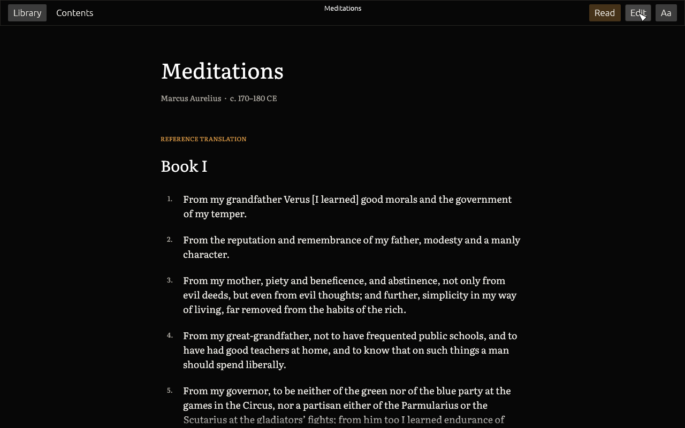

# Skribi

<p align="center">
  <strong>A calm, local-first home for Markdown libraries and Retex vaults.</strong><br />
  Read long works in a focused streaming reader, keep notes as plain files, and never lose them to a proprietary database.
</p>

<p align="center">
  <a href="https://github.com/michael-berardi/skribi/releases/latest"></a>
  <a href="LICENSE"></a>
  
  
</p>

<p align="center">
  <a href="https://github.com/michael-berardi/skribi/releases/latest"><strong>Download</strong></a> ·
  <a href="#start-quickly">Quick start</a> ·
  <a href="#portable-library-format">Library format</a> ·
  <a href="PRIVACY.md">Privacy</a>
</p>

<p align="center">
  
</p>

Skribi reads the folders you already own. Open a Markdown folder, an Obsidian
vault or a Retex vault in place, or import a Notion export, and Skribi gives
complete works and long documents a distraction-free reader with simple
editing on top. Everything stays ordinary Markdown that any text editor can
open.

Skribi is free and open-source software by [Pareto Cybernetics](https://paretocybernetics.com/software/).

## Features

- **Ordinary Markdown:** open any folder directly; files remain readable in every text editor.
- **Separate workspaces:** Library holds complete works while the dedicated Retex tab opens a vault as a collapsible folder tree. Either workspace can be unloaded independently.
- **Retex compatibility:** YAML front matter, atomic edits, stale-write protection, and `.retex/history.jsonl` undo entries use Retex-compatible contracts. Retex is not required.
- **Obsidian support:** open a vault in place or import a clean copy while preserving Markdown, folders, attachments, and wikilinks. `.obsidian` settings are not copied.
- **Notion support:** import a Notion Markdown & CSV ZIP export; remove export IDs from names, repair affected links, preserve assets, and convert CSV databases to Markdown tables.
- **Continuous reading:** chapters stream through one virtualized document surface. The reader includes chapter navigation, a single-edition translation selector, adjustable text size, and six typefaces with multilingual system fallbacks.
- **Mouseia catalog:** browse complete public-domain works by category, hide recommendations locally, or download a work with its original text and every available translation from [mouseia.org](https://mouseia.org/).
- **Adaptive appearance:** the light palette and true-black OLED-friendly dark palette follow the operating-system theme.
- **Library packages:** export and import `.skribi` files. They are safe, bounded ZIP archives containing `library.json`, ordinary Markdown, and assets.
- **Local-first:** no account, sync service, telemetry, or advertising. Opening a Library fetches the public Mouseia catalog index; adding a work fetches that work’s original text and translations.

Skribi supports macOS, Windows, and Linux. It reads Markdown and Notion CSV tables; it does not render EPUB or PDF files.

## Install

Download the build for your platform from the [latest release](https://github.com/michael-berardi/skribi/releases/latest) and verify it against `SHA256SUMS`.

| System | Download |
| --- | --- |
| macOS (Apple Silicon and Intel) | `Skribi-<version>-macos-universal.dmg`, signed and notarized |
| Windows x86_64 | `Skribi-<version>-windows-x86_64.zip` |
| Linux x86_64 | `Skribi-<version>-linux-x86_64.tar.gz` |

`Meditations.skribi` is an optional example library you can open with **Import → Skribi library**.

### Build from source

Requirements: Rust 1.95 or newer and the native window-system packages required by `eframe` on your platform.

```sh
git clone https://github.com/michael-berardi/skribi.git
cd skribi
cargo run --release
```

Open a specific library at launch:

```sh
cargo run --release -- /path/to/library
```

Set `SKRIBI_RETEX=/path/to/vault` to open a separate Retex vault at launch.

## Start quickly

1. Select **Open library folder** to use a Markdown or MOUSEIA folder as a reading library.
2. Select **Retex → Open Retex vault** to browse a notes vault as a hierarchical tree.
3. Select **Import → Notion ZIP** for a Notion `Markdown & CSV` export.
4. Select **Import → Skribi library** for a `.skribi` package.
5. Use **Read / Edit** for the selected document and **Export library** to make a portable `.skribi` package without changing the source folder.

Skribi refuses import symlinks, path traversal, more than 100,000 entries, files above 64 MiB, and archives expanding beyond 1 GiB. Import destinations must be new or empty, so an import cannot silently overwrite existing work.

## Portable library format

A `.skribi` file is a ZIP-compatible archive:

```text
library.json
content/
  document.md
  images/
    cover.png
```

`library.json` identifies format version 1 and lists Markdown documents. Extracting `content/` produces a normal folder; no Skribi runtime is needed to recover or edit it.

The repository includes `examples/meditations`, a public-domain reading library with Marcus Aurelius in the original Greek plus the C. R. Haines (1916) and George Long (1862) translations. The release publishes the same content as `Meditations.skribi`.

## Data and privacy

Skribi reads and writes only folders you choose. It has no analytics, advertising, account system, cloud sync, or background network service. Opening a Library requests the public work index from `mouseia.org`; adding a Mouseia work requests that work’s text. Opening a Markdown link may hand that URL to the operating system. See [PRIVACY.md](PRIVACY.md) and [SECURITY.md](SECURITY.md).

## Development

The deterministic headless UI harness renders the real `eframe` app at 1280 × 800 against the complete 774 KiB *Meditations* corpus: original Greek plus both translations, all twelve books. It exercises the welcome, library, Retex tree, reader, Book XII, and full-text editor states in both palettes, checks that primary content intersects the viewport, and compares GPU snapshots.

```sh
cargo test headless_visual_matrix -- --nocapture
```

After an intentional visual change, inspect every generated image before accepting new baselines:

```sh
UPDATE_SNAPSHOTS=true cargo test headless_visual_matrix -- --nocapture
```

Run the complete local gate before release:

```sh
cargo fmt --check
cargo test
cargo clippy --all-targets -- -D warnings
cargo build --release
```

Release artifacts are built and checked locally, signed where the platform supports it, and published with SHA-256 checksums.

Contributions are welcome under [CONTRIBUTING.md](CONTRIBUTING.md). Skribi is licensed under the [MIT License](LICENSE).
